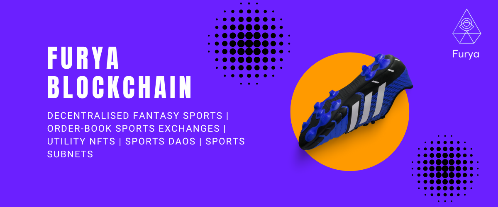

# Furya

Furya is a Cosmos SDK based blockchain here to enhance Web3 individuals, communities & builders experience through an all-in-one hub of dApps.

The Furya Chain is a cutting-edge blockchain platform that lies at the heart of the Furya Hub, a decentralized fantasy sports casino and sports blockchain. 

Designed to provide a trustless play-to-own gaming experience for consumers and businesses alike, the Furya Chain leverages the power and flexibility of blockchain technology to bring unparalleled efficiency, security, and scalability to developers and users alike.

The Furya Chain aims to redefine the gaming and decentralized finance (DeFi) landscapes by providing a robust, scalable, and developer-friendly platform. It serves as the foundational infrastructure for a new era of gaming, betting, and sports financial applications, enabling seamless integration of finance, gaming, and decentralized applications (dApps).

## ✨ Key Features

- **Low Fees and High Transaction Speeds:** Utilizing the Cosmos-SDK for its modular architecture, the Furya Chain offers exceptionally low transaction fees and high throughput, making it ideal for both small and large-scale applications.

- **Modular Architecture:** The flexibility of the Cosmos-SDK allows the Furya Chain to support a wide range of modules, including betting, fantasy sports, casinos, NFTs, and more. This modular approach ensures that the platform can evolve with the needs of its users and developers.

- **Decentralized Finance Capabilities:** With features like the $FURY token, FanClub DAOs, and unique earning mechanisms, the Furya Chain is at the forefront of integrating DeFi into the sports & gaming world, providing users with various ways to earn, spend, and invest within the ecosystem.

- **Community and Developer Support:** The Furya Chain is committed to supporting its community and developers through grant programs, educational resources, and a collaborative development environment. This support aims to foster innovation and growth within the Furya ecosystem.

- **Security and Scalability:** Built with security and scalability in mind, the Furya Chain is designed to accommodate the growing demands of the blockchain and gaming industries, ensuring a reliable and efficient platform for years to come.

## 🪙 FURY Token

The $FURY token is the native cryptocurrency of the Furya Chain, serving as the primary medium for transactions, rewards, and governance within the ecosystem. Its innovative burn mechanism and role in various platform features highlight its importance in maintaining the platform's economy and incentivizing active participation.

## 🤝 Join the Network
Join the vanguard of blockchain sports, gaming and decentralization. Your journey as a Furya Blockchain validator starts now.

## 🔮 Quick Access
|       |                                                                  |                                                                        |
| ----- | ---------------------------------------------------------------- | ---------------------------------------------------------------------- |
| 🎶   | [Ecosystem](/#)                | Deepen your understanding of the Furya ecosystem.                |
| 📓   | [Run a Node](/#) | Learn how to become a node operator, relayer, or validator on Furya.         |
| 🏗️ | [Manage a Node](/#)                          | Guide on how to manage your Furya validator node. |
| 🚰   | [FURY Token](/#)                | Information about the FURY token and its deflationary design.                                   |
| 🧱   | [Modules](/#)                                                      | Modules available within the Furya Binary.                      |

## 🏔️ [Core concepts](/design/core-design-principles)

Every user experience and technical design decision adheres to these principles.

|     |                                                                                                           |                                                                                                                              |
| --- | --------------------------------------------------------------------------------------------------------- | ---------------------------------------------------------------------------------------------------------------------------- |
| 💻 | [Development](/development/basics/cosmjs)                     | Quick start to building dapps on Furya.                                         |
| 🚢 | [Governance](/governance/furyan-council) | All you need to know about the Furyan Council and the governance process. |
| 💳 | [Chain Security](/design/about-fanclubs)             | Learn about Fanclubs that are to engage and reward the community while securing the network.                                               |
| 🪐 | [Contribute](/design/about-fanclubs)                           | Drop your ideas, code and content to help evolve the community.                                                                  |

## 👨‍👩‍👧‍👦 Community

Individually, we're Fans.

> 🧙 Fans
>
> a person who exhibits strong interest or admiration for something or somebody
> admires awesomeness. 

Together, we're Furyans!

> 🧙‍♂️🧙 Furyans
>
> A group of fans who help each other realize their full potential on Furya and become the awesome! Join us on [Telegram](https://t.me/FuryaChain).

## 🪪 [License](https://github.com/furysport/blob/master/LICENSE)
